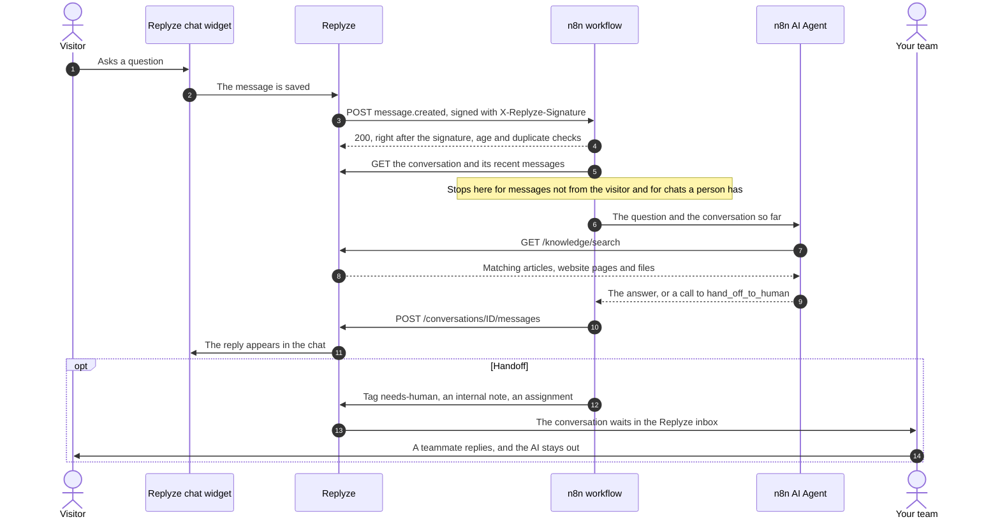

<p align="center">
  <a href="https://replyze.chat/?utm_source=github&utm_medium=referral&utm_campaign=n8n-chat-widget">
    <picture>
      <source media="(prefers-color-scheme: dark)" srcset="https://raw.githubusercontent.com/Replyze/.github/main/assets/logo-on-dark.png">
      
    </picture>
  </a>
</p>

# n8n chat widget for your website, with human handoff

Ready-to-import n8n workflows that put an AI agent you build in n8n behind the [Replyze](https://replyze.chat/?utm_source=github&utm_medium=referral&utm_campaign=n8n-chat-widget) live chat widget. Visitors write in the chat on your website; your n8n AI Agent answers from your Replyze knowledge base; when it can't help, or the customer asks for a person, it hands the conversation to your team in the Replyze inbox and stays out of it. The same workflow answers email, WhatsApp and Telegram conversations too. For n8n users who want a website chatbot with a real support inbox behind it.

**[Create a free account](https://client.replyze.chat/register?utm_source=github&utm_medium=referral&utm_campaign=n8n-chat-widget&utm_content=cta-top)** · [Live demo](https://replyze.chat/?utm_source=github&utm_medium=referral&utm_campaign=n8n-chat-widget&utm_content=live-demo) · [Docs](https://github.com/Replyze/replyze)

The live demo is replyze.chat itself: the chat bubble on that page is the Replyze widget. Every workflow here was run end to end in n8n 2.47.5, against a local stand-in for the Replyze API (see [Testing](#testing)).

## Quickstart

You need a Replyze workspace with API access and n8n 2.7 or later on a public https address ([details](#before-you-start)).

1. **In Replyze:** [sign in or create an account](https://client.replyze.chat/register?utm_source=github&utm_medium=referral&utm_campaign=n8n-chat-widget&utm_content=quickstart). Open **AI Agent** and turn off the switch at the top of the page, so Replyze's own AI doesn't answer as well. Then make an API key under **Settings → Integrations → Developer → New API key**, with **Conversations: Read & write** and **Knowledge base: Read**.
2. **In n8n:** import the workflow (**⋯ → Import → From URL**, `https://raw.githubusercontent.com/Replyze/n8n-chat-widget/main/workflows/replyze-ai-support-agent.json`). Put the API key in the **Replyze API key** credential and your OpenAI key in **OpenAI account**. Publish the workflow and copy the **Production URL** of its *Replyze webhook* node.
3. **Connect them:** in Replyze, **Settings → Integrations → Developer → Webhooks → Add Webhook** with that URL and the event `message.created`. Paste the signing secret it shows into the **Replyze webhook secret: AI agent** credential (the *Sign the raw body* node), then click **Test** next to the webhook: "Test delivered: your endpoint answered HTTP 200."

Each step in detail: [Set up the AI support agent](#set-up-the-ai-support-agent).

## Contents

1. [The workflows](#the-workflows)
2. [How it works](#how-it-works)
3. [This or n8n's own chat embed?](#this-or-n8ns-own-chat-embed)
4. [Before you start](#before-you-start)
5. [Set up the AI support agent](#set-up-the-ai-support-agent)
6. [Workflow 1: AI support agent with human handoff](#workflow-1-ai-support-agent-with-human-handoff)
7. [Workflow 2: new conversation to Slack](#workflow-2-new-conversation-to-slack)
8. [Workflow 3: new lead to Google Sheets](#workflow-3-new-lead-to-google-sheets)
9. [Signature verification](#signature-verification)
10. [Avoid double replies and loops](#avoid-double-replies-and-loops)
11. [Webhook payloads](#webhook-payloads)
12. [Testing](#testing)
13. [Troubleshooting](#troubleshooting)
14. [FAQ](#faq)

## The workflows

| File | What it does | Replyze webhook event | API key access |
|---|---|---|---|
| [`replyze-ai-support-agent.json`](workflows/replyze-ai-support-agent.json) | An n8n AI Agent answers every visitor message from your knowledge base, and hands the conversation to a person when it should | `message.created` | Conversations: Read & write, Knowledge base: Read |
| [`replyze-new-conversation-to-slack.json`](workflows/replyze-new-conversation-to-slack.json) | Posts each new conversation to a Slack channel, with the visitor's first message and a link to the inbox | `conversation.created` | Conversations: Read |
| [`replyze-new-lead-to-google-sheets.json`](workflows/replyze-new-lead-to-google-sheets.json) | Adds every visitor who leaves a name, email or phone to a Google Sheet, and updates the row when their details change | `contact.created`, `contact.updated` | none |

All three use only nodes that ship with n8n (no community nodes) and keep the API key and the signing secrets in n8n credentials, not in the workflow. Before they do anything else, they check the webhook's signature over the raw body, and take the event's age and id from that signed body (see [Signature verification](#signature-verification)). They need **n8n 2.7 or later** (the Crypto node's HMAC secret credential arrived in 2.7) and were tested on n8n 2.47.5.

## How it works



1. The visitor writes in the Replyze widget (or by email, WhatsApp or Telegram).
2. Replyze sends a `message.created` webhook to the n8n Webhook node.
3. n8n checks `X-Replyze-Signature`, the HMAC-SHA256 of the raw body. From that signed body it reads `created_at` and `id`, refuses events more than 5 minutes old, drops events it already has, and answers 200 at once.
4. n8n skips messages that aren't from the visitor (so it never answers its own replies) and conversations a person has taken.
5. The AI Agent node answers, using the Replyze knowledge base as a tool.
6. n8n posts the answer with `POST /api/v1/conversations/{id}/messages`. Without an `agent_id` the reply is from your team, and Replyze delivers it on the conversation's channel.
7. For a handoff, n8n tags the conversation, leaves an internal note with the reason and, if you want, assigns a teammate.

## This or n8n's own chat embed?

n8n has its own chat window, [`@n8n/chat`](https://www.npmjs.com/package/@n8n/chat): you put it on a page and it talks to a workflow that starts with a Chat Trigger node. It's the quickest way to give a workflow a chat front end, and the right choice for a prototype, an internal tool, or a chatbot that never needs a person.

Use the Replyze widget with these workflows when the chat is customer support and people need to be part of it:

| You need | `@n8n/chat` | Replyze widget + these workflows |
|---|---|---|
| A chat window on your site that talks to an n8n workflow | Yes | Yes |
| Your team reads every conversation and replies from an inbox | Build it yourself | Yes: the Replyze inbox |
| The AI steps back when a person takes over | Build it yourself | Yes: tag, assignment or a teammate's reply |
| The same agent on email, WhatsApp and Telegram (Messenger and Instagram in beta) | Separate triggers per channel | Yes: one webhook for all channels |
| Contacts, conversation history across visits, a help center the agent answers from | Build it yourself | Yes |

Both are fine choices. The rest of this page is about the second one.

## Before you start

- **A Replyze workspace** with API access. Whether your workspace has the API depends on its plan: see [pricing](https://replyze.chat/pricing?utm_source=github&utm_medium=referral&utm_campaign=n8n-chat-widget). No account yet? [Sign up](https://client.replyze.chat/register?utm_source=github&utm_medium=referral&utm_campaign=n8n-chat-widget).
- **The chat widget on your website.** The snippet with your token is in the dashboard under **Settings → Integrations → Install widget**. Code for WordPress, Shopify, Wix, Webflow, Next.js and more: [add-live-chat-to-website](https://github.com/Replyze/add-live-chat-to-website).
- **n8n 2.7 or later on a public https address.** Replyze only calls public http(s) addresses: `localhost`, private networks and addresses with a user name or password in them are refused when you save the webhook. n8n Cloud works as it is. Self-hosted n8n needs a public URL (set `WEBHOOK_URL` so the Webhook node shows it).
- **An API key for a chat model.** The workflow uses OpenAI; any n8n chat model that can call tools works (see the [FAQ](#faq)).

## Set up the AI support agent

1. **Turn off Replyze's own AI agent.** Replyze's built-in AI agent is on in every new workspace and answers visitors by itself. In the [dashboard](https://client.replyze.chat/?utm_source=github&utm_medium=referral&utm_campaign=n8n-chat-widget), open **AI Agent**, turn off the switch at the top of the page and confirm with **Turn off**, or visitors can get two answers. Details: [Replyze's AI agent](#1-replyzes-ai-agent).
2. **Make an API key.** In the [dashboard](https://client.replyze.chat/?utm_source=github&utm_medium=referral&utm_campaign=n8n-chat-widget): **Settings → Integrations → Developer → New API key**. Name it "n8n", and under *Access* give **Conversations: Read & write** and **Knowledge base: Read**. Click **Create key** and copy it (`rpz_live_...`): it is shown only once. Owners and admins can make keys.
3. **Import the workflow.** In n8n, create a workflow, open the **⋯** menu → **Import** → **From file** and pick [`workflows/replyze-ai-support-agent.json`](workflows/replyze-ai-support-agent.json). **From URL** works too, with `https://raw.githubusercontent.com/Replyze/n8n-chat-widget/main/workflows/replyze-ai-support-agent.json`.
4. **Fill in two credentials.** Open the nodes that show a credential warning:
   - **Replyze API key** (type *Bearer Auth*): paste the key into **Bearer Token**, without the word "Bearer".
   - **OpenAI account** (type *OpenAI*): your OpenAI API key.
5. **Publish the workflow** and copy the **Production URL** of the *Replyze webhook* node. It looks like `https://your-n8n.example.com/webhook/replyze-ai-agent`. (The Test URL only answers while the editor is listening for a test event, and n8n doesn't keep the duplicate check's memory for test runs.)
6. **Add the webhook in Replyze.** **Settings → Integrations → Developer → Webhooks → Add Webhook**. *Payload URL*: the Production URL. *Events to send*: `message.created`. Click **Save Webhook**, then copy the **signing secret**: it is shown only this once.
7. **Give n8n the signing secret.** In n8n, open the *Sign the raw body* node and fill in its credential **Replyze webhook secret: AI agent** (type *Crypto*): paste the signing secret into **Hmac Secret** and save.
8. **Test.** Next to the webhook in Replyze, click **Test**. You should see "Test delivered: your endpoint answered HTTP 200." Then open your website and ask the chat a question that your knowledge base answers.
9. **Check the rest of your setup:** [auto-assignment](#5-auto-assignment) and [the widget when nobody is online](#6-the-widget-when-nobody-is-online) can keep the n8n agent out of chats. Then choose your options in the workflow's **Settings** node (next section).

## Workflow 1: AI support agent with human handoff

[`workflows/replyze-ai-support-agent.json`](workflows/replyze-ai-support-agent.json)

| Node | What it does |
|---|---|
| Replyze webhook | Receives the event, with **Raw Body** on, so the exact bytes Replyze signed are kept |
| Raw body, Sign the raw body, Check signature, age and id | Verify the signature over those bytes, then take `created_at` and `id` from the signed body: see [Signature verification](#signature-verification) |
| Answer Replyze → Handle it? | Answers Replyze at once (401, 400 or 200), so the model's thinking time never reaches Replyze's 10-second timeout. Only a new, signed, recent event goes on |
| Read the event | Picks out the conversation, the message and its sender |
| From the visitor? | Only `message.created` from `sender_type: "visitor"` with `type: "text"` goes on. Everything else stops here, including this workflow's own replies, and images, files and voice notes, which wait for the team |
| Settings | Your options (below) |
| Get the conversation, Get recent messages | The conversation as it is now (status, assignment, tags) and every message of the last 24 hours. The API sends a conversation's messages oldest first, at most 100 per page, so the node follows `next_cursor` page by page (up to 10 pages) |
| Should the AI answer? | Steps back if a person has the conversation (see [takeover rules](#when-the-ai-steps-back)), and writes the conversation so far for the agent |
| AI support agent | n8n AI Agent with the OpenAI chat model and two tools: `search_knowledge_base` (`GET /api/v1/knowledge/search`) and `hand_off_to_human` |
| Agent answer | The reply, and whether the agent called `hand_off_to_human`. If the model fails or says nothing, the visitor gets your fallback reply and the team gets the conversation |
| Check again before sending, Still unanswered? | The model took a few seconds: if someone answered meanwhile, or the visitor wrote again, nothing is sent |
| Hand off? → Tag for the team → Note for the team → Assign | Tags the conversation, leaves an internal note with the reason, and assigns a teammate if you set one |
| Send the reply | `POST /api/v1/conversations/{id}/messages` with an `Idempotency-Key`, so a retry never sends the reply twice |

### Settings

| Field | Default | What it does |
|---|---|---|
| `handoffTag` | `needs-human` | The tag a handed-off conversation gets. While a conversation has it, the AI stays out. Remove the tag in the inbox to let the AI answer again. Keep it set: it is how the workflow knows the team has the conversation |
| `handoffAgentId` | empty | A teammate's id to assign handed-off conversations to. Empty: nobody is assigned and the conversation waits for whoever picks it up. Ids: `curl https://client.replyze.chat/api/v1/agents -H "Authorization: Bearer $REPLYZE_API_KEY"` |
| `stopWhenAssigned` | `true` | The AI stays out of conversations assigned to a teammate. Set it to `false` if Replyze assigns chats automatically (see [auto-assignment](#5-auto-assignment)) |
| `fallbackReply` | "Thanks for your message! A teammate will reply here soon." | What the visitor gets when the model fails or gives no answer. The conversation is handed off too |

To change how the agent talks, edit the **System Message** under *AI support agent → Options*. It tells the agent to search the knowledge base before it answers, to answer only from what it finds, to hand off when it can't, and to reply in the customer's language. The tool names in it (`search_knowledge_base`, `hand_off_to_human`) are the node names: rename one and change the prompt with it.

### When the AI steps back

*Should the AI answer?* lets the agent answer only when all of these are true:

- The conversation's status is `open` (not `pending`, `snoozed`, `resolved`, `closed` or `spam`).
- It doesn't have the handoff tag.
- It isn't assigned to a teammate (with `stopWhenAssigned` on).
- The workflow could read all of its last 24 hours. A conversation with more than 1,000 messages in a day (10 pages) is left to the team.
- No teammate has replied in it in the last 24 hours. A teammate's reply is `sender_type: "agent"` with a `sender`; this workflow's replies have no `sender`.
- The visitor hasn't written again since (the run for the newest message answers them all), and nobody has answered this message yet.

Each execution in n8n shows the reason it stopped in the output of *Should the AI answer?* (`skipReason`).

## Workflow 2: new conversation to Slack

[`workflows/replyze-new-conversation-to-slack.json`](workflows/replyze-new-conversation-to-slack.json)

`conversation.created` fires once per conversation, at its first message from the visitor or the team. Its payload has the contact, the channel and the inbox link but not the message, so the workflow reads the conversation's first 20 messages with `GET /api/v1/conversations/{id}/messages` (the widget's welcome and other bot lines can come first) and posts:

> **New website chat conversation** from Jana Novak
> \> Hi! Do you have the blue one in size M?
> Open it in Replyze

Conversations your team started (from the inbox or the API) aren't posted.

**Set up:** an API key with **Conversations: Read** in the *Replyze API key* credential; a [Slack incoming webhook](https://api.slack.com/messaging/webhooks) URL in the *Post to Slack* node; then, as in steps 5 to 8 above, a Replyze webhook for `conversation.created` with its signing secret in **Replyze webhook secret: new conversations**. To post somewhere else, replace *Post to Slack* with n8n's Slack, Microsoft Teams, Telegram or Gmail node: the text is in `{{ $json.text }}`.

## Workflow 3: new lead to Google Sheets

[`workflows/replyze-new-lead-to-google-sheets.json`](workflows/replyze-new-lead-to-google-sheets.json)

`contact.created` fires when a contact has a name, email or phone: an anonymous visitor counts from the moment they give one in the chat. `contact.updated` fires when a known contact's details change. The workflow writes one row per contact, matched on `Replyze ID`, so an update changes the row instead of adding one. No API key is needed: the webhook carries the contact.

**Set up:** a Google Sheet with a tab named `Leads` and the header row `Replyze ID, Name, Email, Phone, Company, Job title, City, Country, Language, Tags, First seen, Updated`; your Google account and the sheet's URL in *Add or update the lead*; a Replyze webhook for `contact.created` and `contact.updated` with its signing secret in **Replyze webhook secret: leads**. To send leads to a CRM instead, replace the Google Sheets node with your CRM's node; *Row for the sheet* has every field.

## Signature verification

Every webhook is a JSON `POST` with these headers:

| Header | Value |
|---|---|
| `X-Replyze-Event` | The event name, for example `message.created` |
| `X-Replyze-Signature` | `sha256=` and the hex HMAC-SHA256 of the **raw** request body, keyed with the webhook's signing secret |
| `X-Replyze-Event-Id` | A copy of the body's `id`, the same on every retry. **Not signed** |
| `X-Replyze-Timestamp` | A copy of the body's `created_at`, in Unix seconds. **Not signed** |
| `User-Agent` | `Replyze-Webhooks/1.0` |

Only the body is signed. Anyone who captured a request can send it again with new values in `X-Replyze-Event-Id` and `X-Replyze-Timestamp`, so the workflows don't use those two headers at all: they read the event's time and id from the signed body.

The first nodes of every workflow, in order:

1. **Replyze webhook** has **Options → Raw Body** on, so n8n keeps the exact bytes Replyze sent next to the parsed JSON.
2. **Raw body** (Extract from File, *Extract From Text File*) copies those bytes, as UTF-8 text, into `rawBody`.
3. **Sign the raw body** (Crypto) computes the HMAC-SHA256 of the raw bytes, with the signing secret from a Crypto credential. It has to be the raw bytes: re-serialized JSON can differ from what Replyze signed (Replyze doesn't escape `/` or non-ASCII characters), and then the signature never matches. A Code node can't compute the HMAC on a stock self-hosted n8n, because `require('crypto')` is blocked unless `NODE_FUNCTION_ALLOW_BUILTIN` allows it; the Crypto node needs no settings.
4. **Check signature, age and id** (Code):
   1. compares `sha256=` plus that HMAC with `X-Replyze-Signature`, as UTF-8 bytes and in constant time: every byte is compared whatever the first difference, and a different length fails. No match: **401**, and nothing else happens;
   2. parses `rawBody`, the bytes it just verified, and reads `created_at`. Missing, or more than 5 minutes away from now: **400**. That refuses an old request sent again, whatever its `X-Replyze-Timestamp` says;
   3. reads `id`. An id the workflow has already taken gets **200** and goes no further: it is Replyze's retry, or a replay. A new id is remembered and the event goes on.
5. **Answer Replyze** (Respond to Webhook) sends that answer right away, and **Handle it?** lets only a new event through to the rest of the workflow.

Where the ids are kept: in the workflow's static data (`$getWorkflowStaticData('global')`), each one until its `created_at` is 5 minutes old, when step 2 refuses the event anyway. n8n saves static data only for the published workflow (not for test runs), when a run ends. That catches Replyze's retries (30 seconds and 3 minutes later) and later replays, but it is not a lock: a copy that arrives while the first run is still going gets through, and when runs overlap, the last one to end saves its copy of the ids over the others'. The AI workflow doesn't rely on it alone: it never answers a message that already has an answer, and its reply carries an `Idempotency-Key` (see [Retries and duplicate events](#3-retries-and-duplicate-events)).

Replyze waits 10 seconds for an answer (5 to connect) and doesn't follow redirects. A network error, a timeout or a 5xx is retried twice, after 30 seconds and then 3 minutes, with the same body, so the same `id` and signature; any other answer, 400 and 401 included, is final. Each webhook has its own signing secret, shown once when you add it: lost it? Delete the webhook and add it again.

The **Test** button next to a webhook in the dashboard sends one `webhook.test` event, signed the same way, without retries. It isn't one of the events you can choose and it isn't in the OpenAPI document; its `data` is `{ "message": "This is a test delivery from Replyze." }`. The workflows answer it with 200 and do nothing else.

Need the check in your own code? Node.js, Python and PHP versions, complete receivers and a test vector are in [Replyze/replyze → Webhooks](https://github.com/Replyze/replyze#5-webhooks).

## Avoid double replies and loops

### 1. Replyze's AI agent

Replyze has its own AI agent, and it is on in every new workspace: it answers visitor messages on the website and on the other channels by itself. If it stays on next to this workflow, the visitor can get two answers to the same message.

**Turn Replyze's AI agent off in the workspace you connect to n8n.** In the [dashboard](https://client.replyze.chat/?utm_source=github&utm_medium=referral&utm_campaign=n8n-chat-widget), open **AI Agent** in the menu. The card at the top of the page says *The AI agent is on*: turn its switch off and confirm with **Turn off**. The card then says *The AI agent is off*. The workspace owner and admins can switch it; everyone else in the workspace sees whether it is on.

Off, Replyze's AI sends nothing to customers on any channel: no replies, no handoff messages, and not a reply it was still writing when you switched it off. Messages you set up yourself still go out as before, such as the widget's welcome message, chatbot flows and the closing message. Every visitor message still arrives as `message.created`, so this workflow answers instead. Your knowledge base articles, website pages and files stay, and `GET /api/v1/knowledge/search` keeps searching them. To go back, turn the switch on again: Replyze's AI then answers new messages, so turn this workflow off first.

What happens while it is still on: the workflow checks the conversation again right before it sends (*Check again before sending*) and stays quiet when the message already has an answer, so double replies are unlikely, but Replyze's AI then answers most messages and the n8n agent rarely gets a turn. Workflows 2 and 3 don't answer visitors and work the same with Replyze's AI on or off.

### 2. The workflow never answers itself

Only `message.created` from `sender_type: "visitor"` with `type: "text"` reaches the agent. Replies the workflow posts come back to it as `message.created` with `sender_type: "agent"` and `sender: null`, and stop at *From the visitor?*. Replyze's AI is `sender_type: "bot"` and teammates are `"agent"` with a `sender`: neither goes further. Internal notes (the handoff note) and system lines are never sent as webhooks.

### 3. Retries and duplicate events

Replyze retries an event with the same body, so the same `id`. *Check signature, age and id* drops an id it has already taken (see [Signature verification](#signature-verification)). Behind that, the AI workflow has two guards that don't depend on remembering ids: before it answers, *Should the AI answer?* sees that the message already has a reply, and the reply itself carries `Idempotency-Key: n8n-reply-<message id>`, which Replyze honours for 24 hours. Since n8n answers 200 right after the checks, retries are rare anyway.

### 4. Quick messages in a row

A visitor who sends "Hi", then "Do you ship to Austria?" starts two executions. The older one sees the newer message and stops; the newer one answers both, with the whole conversation in its prompt.

### 5. Auto-assignment

With Replyze's AI off, Replyze tries to assign a conversation every time the visitor writes in it while nobody has it: the first message of a new chat, a visitor who comes back, or a chat that has been waiting. It assigns someone when:

- **Settings → Routing & SLA → Assignment** is *Round robin* or *Least busy*;
- a routing rule (**Settings → Routing & SLA → Routing rules**) assigns the chat to a person, or sends it to a team with **Auto-assign** on;
- the conversation is in a team with **Auto-assign** on (**Settings → Teams**). The team's own method picks someone even when Assignment is *Manual*.

If nobody can take it right then (everyone is offline or at their limit), the chat stays unassigned and the visitor's next message tries again. With `stopWhenAssigned` on, the workflow steps back from every assigned chat, so with any of these it can stay out of most chats, often from the first message. Either keep Assignment on *Manual* with no routing rules or teams that assign automatically, or set `stopWhenAssigned` to `false`: the AI then stops only when a teammate actually replies, or when the conversation has the handoff tag.

### 6. The widget when nobody is online

**Settings → Chat Widget → Forms → When nobody can answer** decides what visitors see when nobody from your team is online and Replyze's AI is off, which is always the case with this workflow:

- **Keep the chat open**: visitors write in the chat, and this workflow answers them. A widget whose owner never changed this setting works this way.
- **Show a contact form** (marked *Default* on that page) and **Contact form whenever the team is offline**: visitors get a contact form instead of the chat whenever your team is offline, so they never reach the n8n agent.

Pick **Keep the chat open**. The *Offline message* on the same page is shown in the chat while nobody is online and no Replyze AI answers: leave it empty or word it so it fits an AI that answers.

## Webhook payloads

Every event has the same envelope:

```json
{
  "id": "0b9f6a52-3c1e-4d7a-9e21-5f8c2b7d1a40",
  "event": "message.created",
  "created_at": "2026-11-13T09:41:07.512000Z",
  "workspace_id": 1,
  "data": { }
}
```

`message.created`: a message from the visitor, the team or the AI (not internal notes, system lines or spam). `data` has the message and its conversation:

```json
{
  "message": {
    "id": 48213,
    "conversation_id": 4812,
    "sender_type": "visitor",
    "sender": null,
    "type": "text",
    "content": "Hi! How long does shipping to Austria take?",
    "attachments": [],
    "ai_generated": false,
    "created_at": "2026-11-13T09:41:07.512000Z"
  },
  "conversation": {
    "id": 4812,
    "status": "open",
    "priority": "normal",
    "subject": null,
    "channel": "web",
    "url": "https://client.replyze.chat/1/inbox?conversation=4812",
    "contact": { "id": 2291, "name": "Jana Novak", "email": "jana@example.com", "phone": null },
    "assigned_agent": null,
    "assigned_team": null,
    "created_at": "2026-11-13T09:40:51.000000Z",
    "resolved_at": null
  }
}
```

| `sender_type` | `sender` | Who wrote it |
|---|---|---|
| `visitor` | `null` | The customer, on any channel |
| `agent` | `{ "id", "name" }` | A teammate, from the inbox |
| `agent` | `null` | Your team through the API: this workflow's replies |
| `bot` | `null` | Replyze's own AI agent (`ai_generated: true`) |

`channel` is the conversation's channel: `web`, `email`, `whatsapp`, `telegram`, `facebook` (Messenger), `instagram` and so on. `type` is `text` for words; an image or a file sent from the widget is `image` or `file`, with the file in `attachments` (`{ url, filename, mime_type, size }`) and, for an image, its URL in `content`. The AI workflow answers `text` only and leaves the rest to the team, as Replyze's own AI does.

`conversation.created`, `conversation.assigned` and `conversation.resolved` carry `data.conversation` (as above). `contact.created` carries `data.contact` (id, name, email, phone, address, website, gender, avatar_url, company, job_title, job_role, company_domain, city, country, country_code, language, tags, segments, custom_data, created_at, updated_at); `contact.updated` also has `data.changed`, the fields that changed. Examples: [`tests/fixtures/`](tests/fixtures/). The schemas of these six events are in the [OpenAPI document](https://github.com/Replyze/replyze/blob/main/openapi.json) under `webhooks`; the dashboard's `webhook.test` (see [Signature verification](#signature-verification)) is not.

### API calls the workflows make

| Call | Scope | Used by |
|---|---|---|
| `GET /api/v1/conversations/{id}` | `conversations:read` | AI agent: status, assignment and tags right now |
| `GET /api/v1/conversations/{id}/messages` | `conversations:read` | AI agent (the last 24 hours, and the check before sending), Slack (the first 20 messages). Oldest first, at most 100 per page (50 if you don't say); `has_more` and `next_cursor` lead to the next page, which the AI workflow follows |
| `GET /api/v1/knowledge/search?q=` | `knowledge:read` | AI agent's `search_knowledge_base` tool: published articles, then website pages and files, best first |
| `POST /api/v1/conversations/{id}/messages` | `conversations:write` | AI agent: the reply (`{ "content" }`) and the handoff note (`{ "type": "note", "content" }`) |
| `POST /api/v1/conversations/{id}/tags` | `conversations:write` | AI agent: the handoff tag (`{ "name" }`, made if the workspace doesn't have it) |
| `POST /api/v1/conversations/{id}/assign` | `conversations:write` | AI agent: assign on handoff (`{ "agent_id" }`) |

Base URL `https://client.replyze.chat/api/v1`, authentication `Authorization: Bearer rpz_live_...`. A key can make 120 requests a minute, and all the keys of a workspace together 600 a minute. One visitor message costs about five requests (one more per extra page of a busy chat or per extra search, three more for a handoff), so one key handles a couple of dozen visitor messages a minute. A 429 answer has `Retry-After`.

The workspace's audit log (**Settings → Audit Log**) shows, under the key's name, every change a key makes (a reply, a note, a tag, an assignment) and its reads of personal data: a conversation, its messages or one of them, and a contact, at most once per key and record every 10 minutes. Lists and knowledge searches aren't logged.

## Testing

`tests/` runs the three workflows in a real n8n against a local stand-in for Replyze, without a Replyze account or an LLM key:

- [`tests/mock-server.mjs`](tests/mock-server.mjs): the Replyze API endpoints above, with the same paths, auth, objects, errors, cursor pagination (oldest first, at most 100 per page) and `Idempotency-Key` behaviour; an OpenAI-compatible chat model with scripted answers (it calls `search_knowledge_base`, or `hand_off_to_human` when the customer asks for a person, then answers from what the tool returned); a Slack webhook and a sheet that record what they get.
- [`tests/replyze-webhook.mjs`](tests/replyze-webhook.mjs): sends webhooks built and signed exactly like Replyze's (same JSON encoding, headers and HMAC), and sends a captured one again with new values in the unsigned headers.
- [`tests/e2e.mjs`](tests/e2e.mjs): imports the workflows into a fresh n8n with the CLI, publishes them, starts n8n on a free port and runs 53 checks. The test copies differ from the files in `workflows/` only in the Replyze and Slack URLs (pointed at the mock) and, in workflow 3, the Google Sheets node (an HTTP request to the mock, since it needs a Google account). Workflow 1 runs twice: as shipped, and with `handoffAgentId` set so the assignment step runs too.

```bash
# once: n8n 2.x needs Node.js 24
npm install --prefix .n8n-test n8n@2.47.5

node tests/e2e.mjs --n8n .n8n-test/node_modules/n8n/bin/n8n
```

What it checks, for each of the three workflows: a fresh, signed event is handled once; the same body sent again with a new `X-Replyze-Event-Id` and a fresh `X-Replyze-Timestamp` gets 200 and is not handled again; a body created 10 minutes ago gets 400 even with a fresh `X-Replyze-Timestamp`, while a fresh body with an hour-old one is accepted; a wrong, an empty and a non-ASCII signature (of the right length) get 401; and nothing is sent anywhere for any of those. For the AI agent also: a signed event with non-ASCII text gets 200 in well under Replyze's 10 seconds; the agent calls the knowledge base and the reply carries its answer and an `Idempotency-Key`; the workflow's own reply, Replyze's AI, a teammate's message and an image upload are ignored; the same message in a new event gets no second answer; in a busy chat (more than one page of messages) a teammate's reply after the first 100 keeps the AI out, and without one the agent answers with the newest messages as its history; a handoff tags, notes, assigns (only when `handoffAgentId` is set) and then replies, in that order; the AI stays out after a handoff, of assigned and pending conversations and after a teammate's reply; two quick messages get one answer; an answer that arrives while the agent thinks cancels the agent's; a model outage gives the fallback reply and a handoff. For Slack and Sheets: new visitor conversations only (also when bot lines come first), leads become rows and updates update them. And no execution fails.

Last run: 53 of 53 checks passed on n8n 2.47.5 and Node.js 24.22.3 (Windows). Run against the previous version of the workflows, which took the time from `X-Replyze-Timestamp`, didn't drop duplicates and read only the first page of messages, the same tests fail 13 of 53: the replay, age, busy-chat and bot-lines checks. What the tests don't cover: a real model's wording and tool choices (the scripted model stands in for OpenAI), the Google Sheets node against Google, importing through the n8n editor (the tests import with the CLI), and replays sent while the first run is still going.

To check your own n8n's signature setup, send a signed test event to it:

```bash
node tests/replyze-webhook.mjs --url https://your-n8n.example.com/webhook/replyze-ai-agent \
  --secret <signing secret> --event webhook.test --data tests/fixtures/webhook.test.json
# HTTP 200 with the right secret; add --bad-signature for a 401, --age 600 for a 400
```

## Troubleshooting

| What you see | Why, and what to do |
|---|---|
| Replyze's **Test** says "HTTP 404" | The workflow isn't published, or the URL is the Test URL. Publish it and use the Production URL |
| Replyze says "Use a public http(s) address for the webhook" | The URL is `localhost`, a private address or has a user name in it. Use n8n Cloud or a public URL for your n8n |
| Replyze's **Test** says "HTTP 401" | The signature doesn't match: the signing secret in the Crypto credential isn't this webhook's. Each webhook has its own |
| Replyze's **Test** says "HTTP 400" and "Too old" | Your n8n server's clock is more than 5 minutes off. Fix the clock (NTP) |
| Replyze's **Test** says "HTTP 3xx" | Replyze doesn't follow redirects. Use the exact https URL n8n shows |
| The test works but the chat never answers | Open the execution in n8n. *Should the AI answer?* shows `skipReason`. If the run stopped at *From the visitor?*, the message wasn't from the visitor or had no text; if it stopped at *Handle it?*, see the output of *Check signature, age and id* |
| `401 invalid_api_key` in an HTTP node | The *Replyze API key* credential: paste only the key, without "Bearer " |
| `403 insufficient_scope` | The key lacks a scope. Make a key with Conversations: Read & write and Knowledge base: Read |
| `403 plan_required` | The workspace's plan doesn't include the API. See [pricing](https://replyze.chat/pricing?utm_source=github&utm_medium=referral&utm_campaign=n8n-chat-widget) |
| `429 rate_limited` | More than 120 requests a minute on this key, or 600 for all the workspace's keys together. Use separate keys for separate workflows, and spread out other API use |
| Visitors get two answers | Replyze's AI agent is still on. Turn it off under **AI Agent**, the switch at the top of the page. See [Replyze's AI agent](#1-replyzes-ai-agent) |
| Visitors see a contact form instead of the chat | **Settings → Chat Widget → Forms → When nobody can answer → Keep the chat open** |
| The AI never answers, or stops answering, in most chats | Replyze assigns chats automatically (Assignment method, a routing rule, or a team with Auto-assign). Set `stopWhenAssigned` to `false`, or see [auto-assignment](#5-auto-assignment) |
| The AI keeps answering after a teammate took the chat | The teammate only assigned it to themselves with `stopWhenAssigned` off. Reply, add the handoff tag, or turn `stopWhenAssigned` on |
| "No HMAC secret set in credentials" | Fill in **Hmac Secret** in the Crypto credential of *Sign the raw body* |
| Replyze's **Test** says "HTTP 500"; n8n says "This operation expects the node's input data to contain a binary file" | **Raw Body** got switched off in the Webhook node's options. Turn it back on |

## FAQ

**Does it answer email, WhatsApp and Telegram too?**
Yes. `message.created` fires for every channel, and a reply through the API goes out on the conversation's channel, as a reply from the inbox does. Messenger and Instagram are in beta in Replyze. The system prompt mentions the channels; change it if you want the agent to write differently by email.

**Can I use Claude, Gemini, Mistral or a local model instead of OpenAI?**
Yes. Replace the *OpenAI chat model* node with any n8n chat model node that supports tool calling and connect it to *AI support agent*. For an OpenAI-compatible service (OpenRouter, Groq, a local server), keep the OpenAI node and set the credential's **Base URL**; the node already has *Use Responses API* off, since most of those services only offer chat completions.

**Where does the agent's knowledge come from?**
From `GET /api/v1/knowledge/search`: your published knowledge base articles and the website pages and files you added in Replyze, found the way Replyze's own AI finds them. Add or fix an article in Replyze and the agent uses it on the next question. It is not everything Replyze's AI uses: the taught answers your team gave it from rated replies, and the instructions on the **AI Agent** page, are not in the search. Put what the n8n agent must know in an article, or in its System Message.

**Who does the reply come from?**
From your team: the API sends it without a teammate's name, so the widget shows it under the widget's bot name. Don't add an `agent_id` to *Send the reply*: a reply with one is a teammate's reply, assigns that teammate an unassigned conversation, and the workflow then steps back from the conversation.

**How do I let the AI back into a handed-off conversation?**
Remove the `needs-human` tag, and the assignment if `stopWhenAssigned` is on. A teammate's first reply in an unassigned conversation assigns it to them, so with `stopWhenAssigned` on the AI stays out of it while it is theirs; with it off, the AI stays out until 24 hours after the teammate's last reply.

**Does the widget show "typing" while n8n works?**
No. Replies arrive as soon as the model is done, usually within seconds.

**Do I need n8n's Chat Trigger node?**
No. The Replyze widget is the chat window; the workflow starts with a Webhook node.

**Is there a Replyze node for n8n?**
Not yet. These workflows use the HTTP Request node with the [REST API](https://github.com/Replyze/replyze#4-rest-api), which has every endpoint they need.

## More from Replyze

| Repository | What is inside |
|---|---|
| [replyze](https://github.com/Replyze/replyze) | Embed code, JavaScript API, REST API, webhooks and the OpenAPI spec |
| [replyze-mcp](https://github.com/Replyze/replyze-mcp) | The Replyze MCP server for Claude, Cursor and VS Code |
| [add-live-chat-to-website](https://github.com/Replyze/add-live-chat-to-website) | Copy-paste install code for every common website platform and framework |
| [wordpress-live-chat](https://github.com/Replyze/wordpress-live-chat) | WordPress live chat and AI chatbot plugin |
| [react-native-live-chat](https://github.com/Replyze/react-native-live-chat) | Live chat and AI support in React Native and Expo apps |
| [flutter-live-chat](https://github.com/Replyze/flutter-live-chat) | Live chat and AI support in Flutter apps |

## License

[MIT](LICENSE). n8n is a trademark of n8n GmbH; this repository is not made or endorsed by n8n.
